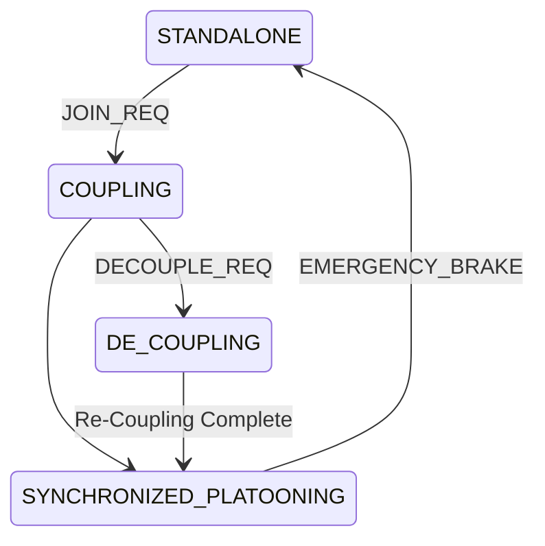
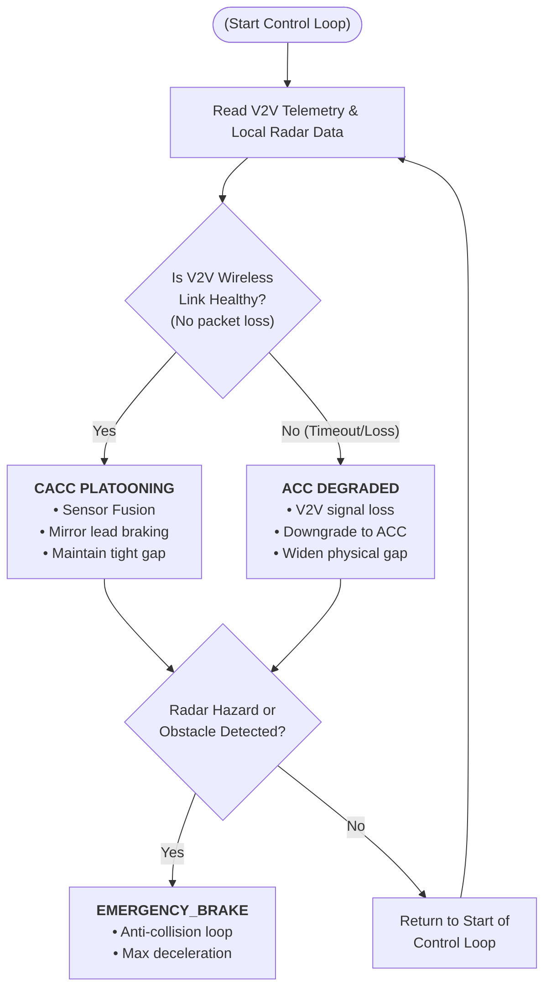

# Truck Platooning Specification

## 1. Data (Telemetry Shared via V2V)
* **`truck_speed` & `truck_acceleration`**: Shared continuously so follower trucks can match the lead truck's pace.
* **`gps_position` (Coordinates)**: Broadcast to synchronize the route and path.
* **`following_distance`**: Measured continuously via Radar to track the real-time gap between vehicles.

---

## 2. Signals (Active Control Directives)
* **Steering & Direction Control Signals**: Manages lateral motion to keep follower trucks centered in the lane.
* **Acceleration Signal**: Controls engine throttle percentage to match the lead vehicle.
* **Braking / Deceleration Signal**: Transmitted over the V2V link to apply brakes simultaneously.
* **Safety Signals**: Instant broadcast of an **Emergency Braking Demand Signal** if the lead truck brakes hard or radar detects an obstacle.

---

## 3. Events (State-Changing Triggers)
* **`evt_request_coupling`**: Triggered when a driver or system initiates platoon formation.
* **`evt_coupling_accept`**: Fired when the follower truck acknowledges connection and synchronizes.
* **`evt_request_decouple`**: Triggered to break formation (e.g., allowing external vehicles to cross between trucks).
* **`evt_emergency`**: Fired when sensors detect an immediate hazard or obstacle.

---

## 4. Protocol Specification
* **Continuous Telemetry**: Trucks continuously stream `truck_speed`, `truck_acceleration`, and `gps_position` over the V2V link to synchronize route and pace. Radar continuously monitors `following_distance` to measure the physical gap.
* **Active Control Directives**: Follower trucks act on lateral steering signals for lane centering and acceleration/deceleration signals to match speed and braking.
* **Safety Overrides**: Emergency braking demands bypass standard loops and instantly broadcast over the low-latency V2V link.

---

## 5. State Machine

* **STANDALONE**: The truck operates independently until platoon formation is initiated via `evt_request_coupling`.
* **COUPLING**: The trailing truck processes the join request and synchronizes speed and position. The state transitions to platooning when `evt_coupling_accept` is received.
* **PLATOONING**: The core operational state where telemetry and control signals are continuously exchanged.
  * **Transition A**: If external traffic needs to pass, `evt_request_decouple` transitions the system to `DECOUPLING`.
  * **Transition B**: If an obstacle is detected, `evt_emergency` triggers an emergency response[cite: 3, 4].
* **DECOUPLING**: Triggered by `evt_request_decouple`, the automated system adjusts braking signals to increase `following_distance` and open a safe gap.
* **EMERGENCY**: Triggered by `evt_emergency`, safety signals immediately command emergency braking to bring the platoon to a safe stop.

---

## 6. Distance Guarantee & Control Behavior
* **Sensor Fusion**: Distance to the preceding truck is guaranteed by combining local onboard radar measurements with real-time V2V telemetry.
* **Predictive Control**: Follower trucks utilize Cooperative Adaptive Cruise Control (CACC) to instantly mirror the lead truck's braking and acceleration signals, minimizing reaction delays.
* **Continuous Verification**: Radar actively tracks the physical headway to cross-check V2V speed commands, ensuring the actual gap matches the intended target distance.

---

## 7. System Robustness & Communication Failure
* **Signal Loss Detection**: If the V2V wireless link fails, the follower vehicle stops receiving the lead truck's predictive telemetry and state commands.
* **Degraded Fallback**: The system remains robust by automatically downgrading from tight-gap platooning to standard autonomous Adaptive Cruise Control (ACC).
* **Gap Expansion**: To ensure stability without zero-latency data, the follower truck safely decelerates using local radar to widen the gap to a standard highway following distance.

---

## 8. Model-Based Specification (Failure State Machine)

### State Definitions & Transitions

* **`CACC_PLATOONING`**: The truck operates with a close aerodynamic gap, relying on both V2V communication and radar.
  * *Transition*: V2V heartbeat timeout or high packet loss triggers a system downgrade to `ACC_DEGRADED`.
* **`ACC_DEGRADED`**: The system relies strictly on local vehicle detection and anti-collision technologies, maintaining a widened, safe physical distance.
  * *Transition*: Radar detects an unexpected obstacle or rapid lead deceleration, triggering `EMERGENCY_BRAKE`.
* **`EMERGENCY_BRAKE`**: Immediate override state that applies maximum braking force to prevent a collision.
  * *Transition*: Resets mode once the vehicle completely stops or the hazard clears.