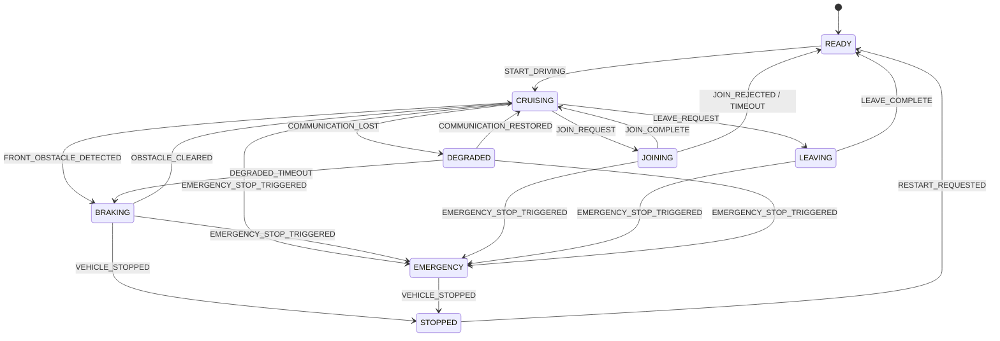
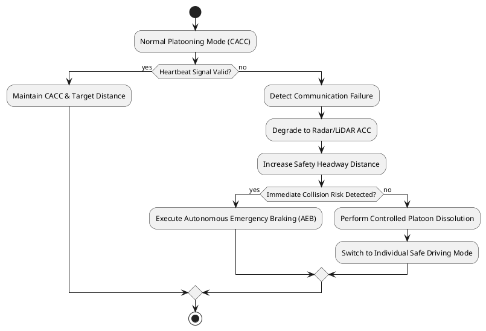

# Truck Platooning System Specification

## 1. Platooning Communication Protocol

The system relies on a dedicated Truck Platooning Communication Protocol to define how four trucks communicate and cooperate smoothly within a platoon formation.

* Vehicle Identification: Each truck is assigned a unique `Truck_ID` and shares a common `Platoon_ID`.
* Telemetry Broadcasting: The Lead Truck periodically broadcasts its position, speed, acceleration, and driving status to all trailing vehicles.
* Sensor Cross-Verification: Each Following Truck receives broadcast telemetry and verifies it against local sensor data.
* Heartbeat Monitoring: Trucks continuously send `HEARTBEAT` messages (e.g. every 100 ms) to monitor network health. If no message is received within a defined threshold (e.g. 300 ms), the truck raises a `COMMUNICATION_LOST` signal.
* Safety Alerts: Obstacle warnings and emergency braking messages are immediately broadcast to all relevant trucks.
* Message Acknowledgement: Crucial control commands require explicit `ACK` signals from receiving vehicles.
* Degraded Mode: If communication fails, affected trucks enter a `DEGRADED` state, switching to sensor-based driving with an increased safety margin.
* Formation Management: Joining and leaving the platoon follow defined procedures:
  * Joining: The joining truck sends a `JOIN_REQUEST`. The Lead Truck accepts or rejects it. The joining truck confirms with `JOIN_COMPLETE` once in position.
  * Leaving: The leaving truck sends a `LEAVE_REQUEST`. Upon acceptance by the Lead Truck, the leaving truck confirms with `LEAVE_COMPLETE` after creating a safe distance.

---

## 2. High-Level State Transitions

A State Machine describes the operational states of each truck and the events triggering transitions between them.

### State Transition Matrix

| Current State | Event | Next State | Action |
| --- | --- | --- | --- |
| READY | START_DRIVING | CRUISING | Start driving |
| CRUISING | FRONT_OBSTACLE_DETECTED | BRAKING | Reduce speed |
| CRUISING | JOIN_REQUEST | JOINING | Start joining procedure |
| CRUISING | LEAVE_REQUEST | LEAVING | Start leaving procedure |
| CRUISING | COMMUNICATION_LOST | DEGRADED | Enter safe operating mode |
| BRAKING | OBSTACLE_CLEARED | CRUISING | Resume speed |
| BRAKING | VEHICLE_STOPPED | STOPPED | Maintain stopped state |
| JOINING | JOIN_COMPLETE | CRUISING | Join the platoon formation |
| JOINING | JOIN_REJECTED / TIMEOUT | READY | Cancel joining procedure |
| LEAVING | LEAVE_COMPLETE | READY | Leave the platoon |
| DEGRADED | COMMUNICATION_RESTORED | CRUISING | Resume cooperative driving |
| DEGRADED | DEGRADED_TIMEOUT | BRAKING | Stop safely |
| Any active state\* | EMERGENCY_STOP_TRIGGERED | EMERGENCY | Initiate emergency braking |
| EMERGENCY | VEHICLE_STOPPED | STOPPED | Maintain stopped state |
| STOPPED | RESTART_REQUESTED | READY | Prepare to restart |

*\*Active states include CRUISING, BRAKING, JOINING, LEAVING, and DEGRADED.*

### High-Level State Diagram

---

## 3. Guaranteed Distance Control Strategy

To maintain a dynamic and safe inter-vehicle distance behind the preceding truck, the system uses a dual-layer sensing and control architecture.

1. **V2V Cooperative Control (Primary Layer):**
   * Preceding trucks broadcast real-time telemetry (speed, acceleration, braking intent) via C-V2X or DSRC at high frequencies (10 Hz to 50 Hz).
   * Enables Cooperative Adaptive Cruise Control (CACC), allowing tighter headway distance ($d_{ref}$) and faster reaction to speed changes.

2. **On-Board Sensor Fallback (Secondary Layer):**
   * Physical sensors (LiDAR, Radar, Cameras) continuously measure actual distance ($d_{actual}$) and relative speed.
   * Target headway distance is dynamically calculated using a headway time policy:
     $$d_{ref} = d_{min} + h \cdot v$$
     *(where $d_{min}$ is standstill distance, $h$ is time headway, and $v$ is truck speed)*.
   * If V2V data exhibits jitter or discrepancy against physical sensors, the controller prioritizes physical sensor readings to prevent collision.

---

## 4. Communication Failure Handling (Fault-Tolerant Protocol)

### 4.1 Failure Detection Mechanisms
* **Heartbeat Timeout:** Preceding and following trucks monitor periodic heartbeat signals. If a signal is missing beyond $T_{timeout}$, communication failure is declared independently.
* **Direct Signal Loss:** Transceiver hardware instantly reports disconnection.

### 4.2 Emergency Response Sequence
1. **Emergency Warning:** Broadcast an emergency alert signal to surrounding vehicles.
2. **Fallback to Sensor-ACC:** Degrade from CACC to radar/LiDAR-based Adaptive Cruise Control (ACC) and increase headway time $h$.
3. **Platoon Dissolution:** Suspend platoon formation and transition trucks to independent safe operation.
4. **Safe Stop & Recovery:** If immediate collision risks are detected or severe faults persist, initiate emergency braking (AEB) or pull over safely to the shoulder.

---

## 5. Simplified Activity Diagram (Communication Failure Response)

Below is the streamlined Activity Diagram specifying the exact control behavior when a communication loss occurs.

---

## 6. Conclusion

This model-based specification ensures that the truck platooning system maintains precise distance control during normal operations while guaranteeing safety under dynamic failures. By utilizing V2V communication paired with local sensor verification, implementing a Fault-Tolerant Protocol, and defining formal State Machines and Activity Diagrams, the system guarantees both operational efficiency and robust collision avoidance.