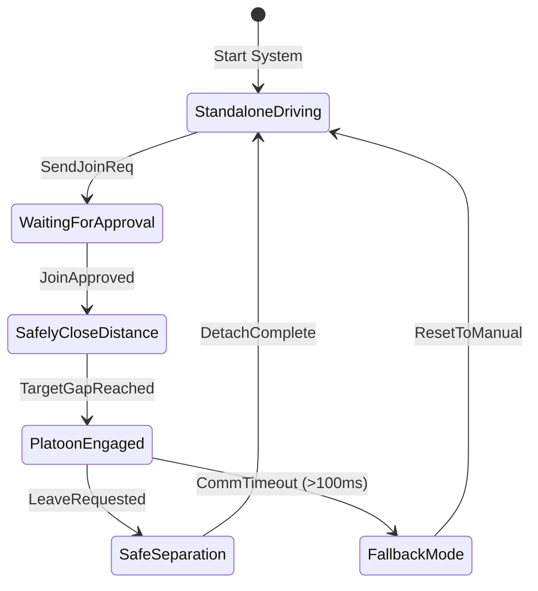
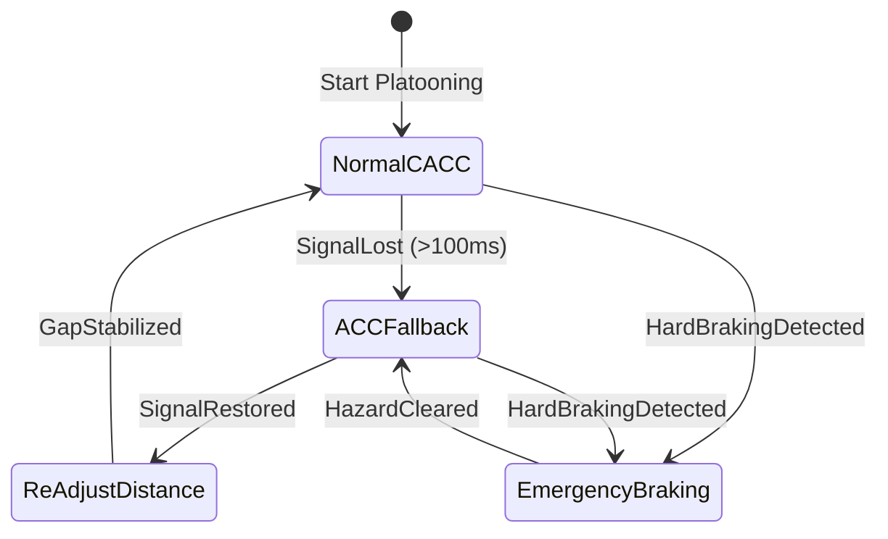

# Task 1
### Data and signals needed
* Join Request / Accept: A new truck asks the lead truck if it can join, and gets assigned its spot in line.
* Lead Truck Status: Leader sends overall platoon speed and route changes.
* Preceding Truck Status: The truck directly ahead sends its exact speed and braking signal so the truck behind can react instantly.
* Radar Sensor Data: The follower truck constantly measures the real-time distance and relative speed to the truck in front.
* Safety Check: A continuous signal check to make sure communication is still active.

### Communication protocols
* Fast Loop (High Priority): Quick messages every 20 milliseconds between neighboring trucks to sync braking and accelerating.
* Slow Loop: Messages every 100 milliseconds from the leader for adding/removing trucks and setting overall speeds.

### Communication state machine

# Task 2
### Control behaviour
* Platooning uses wireless data so when the front truck hits the brakes, the follower brakes at the exact same moment.
* If no signal arrives within 100 milliseconds, a timeout triggers. The system instantly drops down to standard radar-based cruise control. The system smoothly backs off from a tight gap (0.5 seconds) to a safer standalone gap (1.5 seconds). If the front truck slams its brakes while communication is lost, automatic emergency braking takes over using radar to prevent a crash.

### Control behaviour state machine
